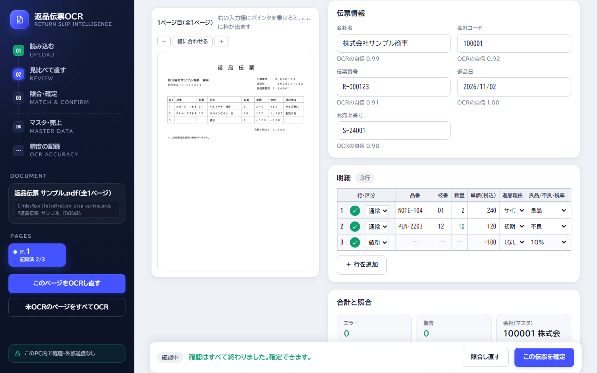

# ポートフォリオ

 自動テスト162件（push のたびに GitHub Actions で実行）

| 作品 | 概要 |
|---|---|
| [返品伝票OCR](return_slip_ocr/) | 返品伝票PDFをOCRで読み取り、マスタ・売上データと照合して、人が確認・確定したものだけを基幹システム取込用Excelに出すローカルWebアプリ（Python / Flask / EasyOCR / SQLite）。OCRの正解率を架空伝票で計測し、54.2% → 97.4% まで改善 |

- 設計書とレビュー記録：[要件定義書](return_slip_ocr/docs/要件定義書.md) / [基本設計書](return_slip_ocr/docs/基本設計書.md) / [データ設計書](return_slip_ocr/docs/データ設計書.md) / [テスト仕様書](return_slip_ocr/docs/テスト仕様書.md) / [レビュー記録](return_slip_ocr/docs/レビュー記録.md)
- 進め方：Issue → ブランチ → Pull request → マージ（[Issues](../../issues?q=is%3Aissue) / [Pull requests](../../pulls?q=is%3Apr)）
- AIツールの活用：設計書・コード・テストは Claude Code で作成し、業務の観点からレビューして直した（詳しくは [return_slip_ocr/README.md](return_slip_ocr/README.md)）
