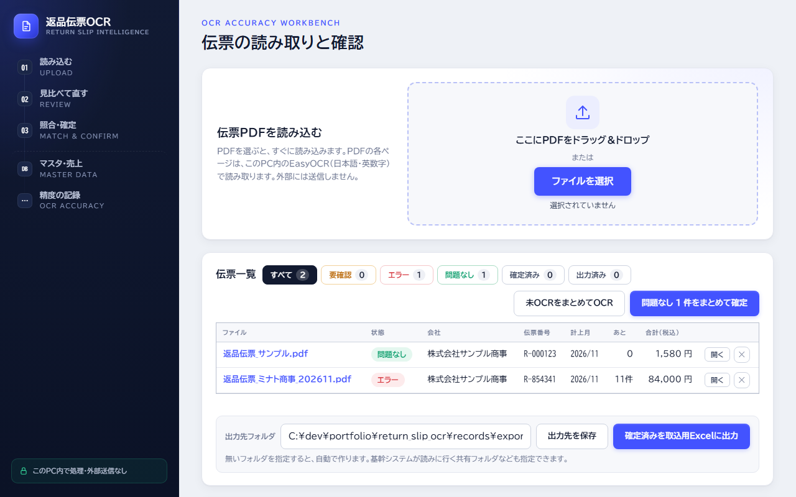
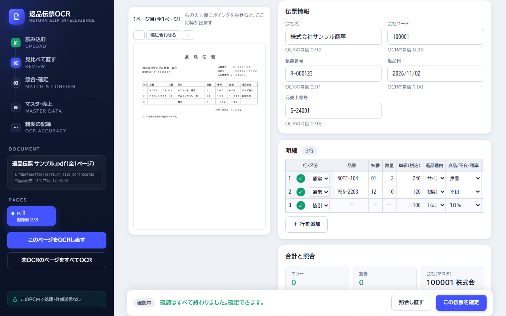
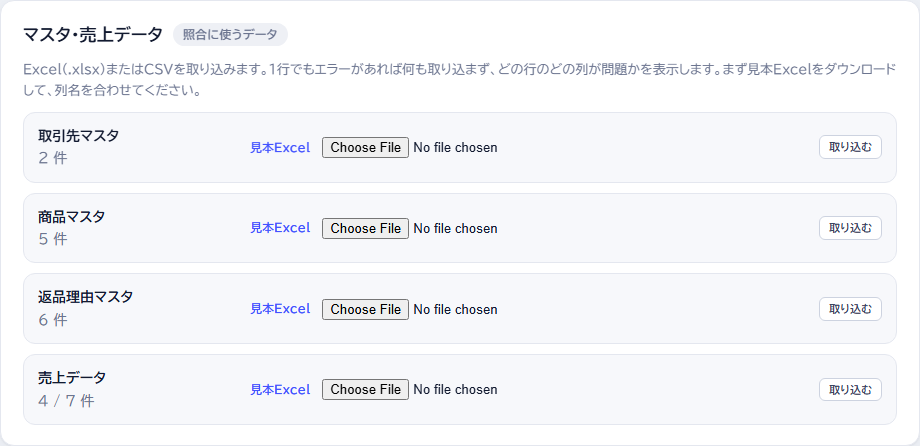

# 返品伝票OCR（読み取り → マスタ照合 → 人が確認 → 基幹システム取込用Excel）

[](https://github.com/kanaoda0114/portfolio/actions/workflows/tests.yml)

返品伝票のPDFをOCRで読み取り、**マスタ・売上データと照合して、人が確認・確定したものだけを基幹システム取込用Excelに出す**ローカルWebアプリです。

「OCR（AI）に読ませて終わり」ではなく、**AIの出力を人が検証し、迷うところは人に判断を任せ、精度を数字で測りながら改善する**ことを目的にしています。

## 画面

**伝票一覧**：PDFをまとめて読み込み、伝票ごとの状態（要確認・エラー・問題なし・確定済み）を見て、問題のあるものだけ開く


**作業画面**：左に伝票の画像、右にOCRの結果と入力欄。OCRの自信度を表示し、黄色の欄だけ人が確認する


**マスタ・売上データ**：照合に使うデータをExcel／CSVから取り込む（1行でもエラーがあれば取り込まず、どの行のどの列かを表示）


## できること

- PDFをドラッグ＆ドロップ（複数可）すると、ページを画像化して日本語OCR（EasyOCR）を実行
- 明細表の見出しと罫線の位置から、各文字を「行 × 項目」へ自動で割り当て
  - 欄ごとに出てくる文字だけに絞って読み直す（数量は数字だけ、品番は英数字とハイフンだけ）
  - O/0 など取り違えやすい文字は、**マスタの値が1つだけ当てはまるときに限って**直す
  - 自信のない文字は**割り当てずに残し、人に判断を任せる**
- 取引先・商品・返品理由マスタと売上データ（SQLite）と照合し、エラー・警告を表示
  - 会社コードが無い、元売上に無い品番、売上数量を超える返品、金額の計算違いなど
- 人が確認・確定した伝票だけを、基幹システム取込用Excelに出力（出力履歴つき）
- OCRの正解率を架空伝票で計測し、改善の前後を数字で比べる（`docs/test_reports/`）
  - 同じ30枚で **54.2% → 97.4%**（[要件定義書 F3.1](docs/要件定義書.md)）

## 設計で気をつけたこと

| 方針 | 内容 |
|---|---|
| データを外に出さない | OCRはすべてPC内で実行。サーバーは `127.0.0.1` のみで待ち受け |
| 推測で埋めない | 文字の割り当ては位置だけで行い、内容から値を補完しない |
| 判定の根拠を残す | 「表記差」で一致とした場合、使った揃え方を記録する |
| 利用者が自分で直せるエラー | エラーごとに「原因」と「対処方法」を日本語で表示 |
| 記録を壊さない | ファイルは一時ファイル経由で書き込み（途中で落ちても壊れない） |

## 構成

```
PDF ──▶ pdf_renderer（PyMuPDFで画像化）
          ──▶ ocr_engine（EasyOCR：文字・位置・信頼度）
                ──▶ table_lines / table_mapper（罫線と見出しから明細の行×項目に割り当て）
                      ──▶ ocr_refine（欄ごとに文字を絞って読み直し）
                            ──▶ candidates（マスタの値で取り違え文字を直す）
                                  ──▶ slip_check（マスタ・売上と照合してエラー・警告）
                                        ──▶ 画面で人が確認・確定
                                              ──▶ excel_export（基幹システム取込用Excel）
```

| ファイル | 役割 |
|---|---|
| `app.py` | Flask のAPI（アップロード・OCR・確認結果の保存） |
| `config.py` | 設定値（解像度・しきい値・対象項目など）を1か所に集約 |
| `services/pdf_renderer.py` | PDFの検証（暗号化・破損・偽装ファイル）と画像化 |
| `services/ocr_engine.py` | EasyOCRの初期化（1回だけ）と実行（排他制御つき） |
| `services/ocr_pipeline.py` | OCR → 明細の割り当て → 欄の読み直し、の流れを1つにまとめる |
| `services/ocr_refine.py` | 欄を切り出し、列に出る文字だけに絞って読み直す（精度向上） |
| `services/table_mapper.py` | 見出し位置から列を決め、文字枠を明細へ割り当て |
| `services/review.py` | 表記ゆれの正規化、判定、集計、CSV出力 |
| `services/doc_store.py` | PDFごとの記録フォルダ管理 |
| `static/`, `templates/` | 画面（HTML / CSS / JavaScript） |
| `check_ocr.py` | 画面を使わずOCRだけ確認するコマンド |
| `tools/ocr_benchmark.py` | 正解つきの架空伝票を自動生成してOCRの正解率を測る（`docs/test_reports/` に結果） |

## 使用技術

Python 3.13 / Flask / PyMuPDF / EasyOCR（PyTorch）/ NumPy / HTML・CSS・JavaScript

## 動かし方（Windows）

```bash
cd return_slip_ocr
py -m venv .venv
.venv\Scripts\pip install -r requirements.txt
.venv\Scripts\python app.py
```

ブラウザで http://127.0.0.1:5000 を開きます。初回はOCRモデルのダウンロードに時間がかかります（ダウンロードされるのはモデルだけで、PDFは送信しません）。

## テスト

```bash
.venv\Scripts\python -m pytest -q
```

- 自動テスト 162件（`tests/`）。OCRエンジンは偽の reader に置き換えて、割り当て・読み直し・照合・Excel出力・APIの動きを確かめる
- GitHub に push すると [GitHub Actions](../.github/workflows/tests.yml) が同じテストを自動で実行し、結果が先頭のバッジに出る
- OCRそのものの正解率は `tools/ocr_benchmark.py` で別に計測する（`docs/test_reports/`）

## 開発のきっかけ

営業事務の担当者が、紙やPDFで届く返品伝票の確認・入力に、毎回何時間もかけていました。
OCRで読み取りを自動化できれば負担を減らせますが、読み取りを間違えると請求額までずれてしまいます。
そこで、まず「OCRがどれくらい正しく読めるか」を人が確かめて記録できるアプリを、個人で作りました。
（業務の困りごとをヒントに、自分のPCと時間で作成したもので、実際の伝票やデータは含みません）

## AIツールの活用

| 段階 | 使ったAI | AIに任せたこと | 自分で判断・確認したこと |
|---|---|---|---|
| 最初の開発 | ChatGPT | コードの作成 | 業務の課題から要件を決める（PDFを外に送らない／正解は人が決める／迷ったら勝手に決めない）、実際に動かして確認 |
| 機能追加（設計〜テスト） | Claude Code | 設計書・コード・自動テストの作成 | 設計書のレビュー（5件の指摘）、出力先の決め方・フォルダが無いときの動き・セキュリティなどの指摘、Issue → ブランチ → PR → レビュー → マージの流れで進行 |

### 設計書とレビュー
- [要件定義書](docs/要件定義書.md) / [取込フォーマット定義書](docs/取込フォーマット定義書.md)：複数PDF読み込みと販売管理システム取込用Excel出力の設計（AIが作成）
- [レビュー記録](docs/レビュー記録.md)：AIが作った設計書を人がレビューし、5件の問題（業務の抜け漏れ・仕様の決めつけなど）を見つけて直した記録
