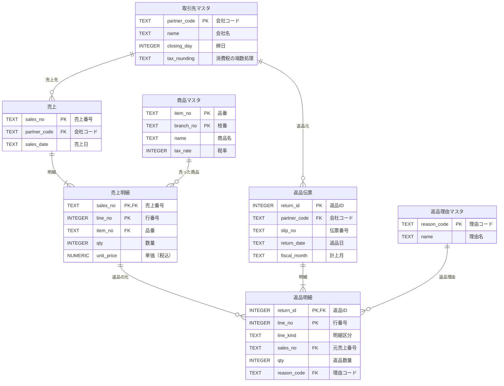

# データ設計書：マスタ・売上データ・返品記録

| 項目 | 内容 |
|---|---|
| 対象 | 返品伝票OCR（return_slip_ocr） |
| 版 | 1.1 |
| 関連 | [要件定義書](要件定義書.md) 1.4版 F8・F9 / [返品計上Excel定義書](返品計上Excel定義書.md) |
| データベース | SQLite（`records/returns.db`）。Python標準の sqlite3 で扱い、追加のサーバーは不要 |

## 改訂履歴

| 版 | 内容 |
|---|---|
| 1.0 | 初版 |
| 1.1 | ER図を日本語に変更。返品理由マスタを追加（Q12）。単価・金額を税込に変更（Q9）。返品明細に明細区分（通常／値引）・税率の決め方（按分）を追加（Q11・Q15）。返品伝票に計上月・締め日・締め日超過を追加（Q10・Q14） |

## 1. 考え方

| 方針 | 内容 |
|---|---|
| **OCRで読むのは最小限** | 伝票から読むのは、伝票ごとに変わる値だけ（会社名・会社コード・伝票番号・返品日・元売上番号・品番・枝番・数量・単価・返品理由） |
| **それ以外はマスタから引く** | 商品名・税率・インボイス登録番号・端数処理・締日などは、毎回同じ値なのでマスタに1回だけ持つ |
| **マスタは照合に使い、上書きしない** | OCRの値とマスタ・売上の値が違っても、黙って置き換えない。違いを警告として見せ、人が決める |
| **返品は「元の売上」と照らし合わせる** | 返品は前に売ったものが戻ること。売ったときの単価・数量と比べる |
| **金額は税込で持ち、消費税は計算する** | 伝票・売上の単価は税込（Q9）。消費税は税率ごとに税込合計から計算する（要件定義書 F5） |
| **持たない情報は持たない** | 口座番号など、返品計上に使わない大事な情報は、このツールでは持たない |

## 2. テーブルの関係（ER図）

（図には主な列だけを載せています。全部の列は3章）

| つながり | 意味 |
|---|---|
| 取引先マスタ 1 ── 多 売上 | 1つの会社に、売上がいくつもある |
| 売上 1 ── 多 売上明細 | 1枚の売上伝票に、明細の行がいくつもある |
| 商品マスタ 1 ── 多 売上明細 | 1つの商品が、いくつもの売上明細に出てくる |
| 売上明細 1 ── 多 返品明細 | 1つの売上明細が、何回かに分けて返品されることがある |
| 取引先マスタ 1 ── 多 返品伝票 | 1つの会社から、返品伝票がいくつも届く |
| 返品伝票 1 ── 多 返品明細 | 1枚の返品伝票に、明細の行がいくつもある |
| 返品理由マスタ 1 ── 多 返品明細 | 1つの返品理由が、いくつもの返品明細で使われる |

## 3. テーブル定義

凡例：◆＝主キー（その行を1つに決める項目）、→＝外部キー（ほかのテーブルを参照）、必須＝空にできない
（列名の `m_partner` などは、データベースの中で使う名前）

### 3.1 取引先マスタ（m_partner）

| 列名 | 日本語名 | 型 | 必須 | 説明 |
|---|---|---|---|---|
| ◆partner_code | 会社コード | TEXT | ○ | 6桁（要件定義書 Q8） |
| name | 会社名 | TEXT | ○ | 正式名称 |
| name_kana | 会社名カナ | TEXT | | 並べ替え・検索用 |
| aliases | 別名 | TEXT | | 略称など。`;` 区切り（例：`サンプル商事;(株)サンプル商事`） |
| invoice_no | インボイス登録番号 | TEXT | | `T` ＋13桁 |
| closing_day | 締日 | INTEGER | ○ | 1〜28、末日は `99`（計上月の計算に使う） |
| payment_site | 支払サイト | TEXT | ○ | 例：`翌月末`、`翌々月10日` |
| tax_rounding | 消費税の端数処理 | TEXT | ○ | `切り捨て` / `四捨五入` / `切り上げ` |
| active | 有効 | INTEGER | ○ | 1：有効、0：取引終了 |
| updated_at | 更新日時 | TEXT | ○ | 取り込んだ日時 |

### 3.2 商品マスタ（m_item）

| 列名 | 日本語名 | 型 | 必須 | 説明 |
|---|---|---|---|---|
| ◆item_no | 品番 | TEXT | ○ | |
| ◆branch_no | 枝番 | TEXT | ○ | 色・サイズなど。無い商品は空文字 `''` |
| name | 商品名 | TEXT | ○ | |
| unit | 単位 | TEXT | | 例：個、冊、箱 |
| tax_rate | 税率 | INTEGER | ○ | `10` / `8`（軽減税率） |
| active | 有効 | INTEGER | ○ | |
| updated_at | 更新日時 | TEXT | ○ | |

### 3.3 返品理由マスタ（m_return_reason）

| 列名 | 日本語名 | 型 | 必須 | 説明 |
|---|---|---|---|---|
| ◆reason_code | 理由コード | TEXT | ○ | 例：`01` |
| name | 理由名 | TEXT | ○ | 例：`サイズ違い` |
| aliases | 別の書き方 | TEXT | | 伝票に書かれる言い方。`;` 区切り（例：`サイズ間違い;サイズ違ひ`） |
| sort_order | 表示順 | INTEGER | ○ | 選択肢の並び順 |
| active | 有効 | INTEGER | ○ | |

- OCRで読んだ返品理由の文字を、理由名・別の書き方と照らし合わせてコードにする
- 見つからないときは、**選択肢から人が選ぶ**（近い言葉を推測で選ばない）
- 返品理由から良品／不良を自動で決めることはしない（良品／不良は現物を見て人が選ぶ）

### 3.4 売上（t_sales）・売上明細（t_sales_line）

販売管理システムから出した売上データ（CSV / Excel）を取り込む。このツールでは**変更しない**（参照するだけ）。

**売上（t_sales）**

| 列名 | 日本語名 | 型 | 必須 | 説明 |
|---|---|---|---|---|
| ◆sales_no | 売上番号 | TEXT | ○ | 納品書番号。返品伝票に「元伝票番号」として書かれることがある |
| →partner_code | 会社コード | TEXT | ○ | 取引先マスタ |
| sales_date | 売上日 | TEXT | ○ | `YYYY-MM-DD` |

**売上明細（t_sales_line）**

| 列名 | 日本語名 | 型 | 必須 | 説明 |
|---|---|---|---|---|
| ◆→sales_no | 売上番号 | TEXT | ○ | 売上 |
| ◆line_no | 行番号 | INTEGER | ○ | |
| →item_no | 品番 | TEXT | ○ | 商品マスタ |
| →branch_no | 枝番 | TEXT | ○ | 商品マスタ |
| qty | 数量 | INTEGER | ○ | 売った数 |
| unit_price | 単価（税込） | NUMERIC | ○ | 売ったときの単価 |
| amount | 金額（税込） | INTEGER | ○ | |

### 3.5 返品伝票（t_return_slip）・返品明細（t_return_line）

このツールで**確定した返品**を記録する。「売った数 − すでに返品した数」（返品できる残り）を数えるためにも使う。

**返品伝票（t_return_slip）**

| 列名 | 日本語名 | 型 | 必須 | 説明 |
|---|---|---|---|---|
| ◆return_id | 返品ID | INTEGER | ○ | 自動採番 |
| →partner_code | 会社コード | TEXT | ○ | |
| slip_no | 伝票番号 | TEXT | ○ | 返品伝票の番号。`(partner_code, slip_no)` で重複させない |
| return_date | 返品日 | TEXT | ○ | |
| fiscal_month | 計上月 | TEXT | ○ | `YYYY-MM`。返品日と取引先の締日から計算（Q10）。締め日を過ぎて確定したときは、確定日の締め期間（Q14） |
| closing_date | 締め日 | TEXT | ○ | 計上月の締め日 `YYYY-MM-DD` |
| late | 締め日超過 | INTEGER | ○ | 1：返品日の締め日を過ぎて確定したため、次の締め期間に回した |
| source_file | 元ファイル名 | TEXT | ○ | 読み取ったPDF |
| status | 状態 | TEXT | ○ | `確定済み` / `出力済み` |
| confirmed_at | 確定日時 | TEXT | ○ | |
| exported_at | 出力日時 | TEXT | | |

**返品明細（t_return_line）**

| 列名 | 日本語名 | 型 | 必須 | 説明 |
|---|---|---|---|---|
| ◆→return_id | 返品ID | INTEGER | ○ | 返品伝票 |
| ◆line_no | 行番号 | INTEGER | ○ | |
| line_kind | 明細区分 | TEXT | ○ | `通常` / `値引`（Q11） |
| →sales_no | 元売上番号 | TEXT | 通常のみ○ | 照合した売上明細 |
| →sales_line_no | 元売上行番号 | INTEGER | 通常のみ○ | |
| item_no / branch_no | 品番・枝番 | TEXT | 通常のみ○ | |
| qty | 返品数量 | INTEGER | ○ | 値引は `1` |
| unit_price | 単価（税込） | NUMERIC | ○ | 伝票の単価（人が確定した値）。値引は値引額をマイナスで |
| amount | 金額（税込） | INTEGER | ○ | 数量 × 単価 |
| tax_mode | 税率の決め方 | TEXT | ○ | `10` / `8` / `按分`。通常の行は商品マスタの税率。値引の行は人が選ぶ（Q15） |
| tax_rate | 税率 | INTEGER | | 通常の行と、値引で `10`・`8` を選んだ行。`按分` の行は空（出力のときに税率ごとに分けて計算する） |
| →reason_code | 理由コード | TEXT | ○ | 返品理由マスタ |
| reason_text | 返品理由（伝票の文字） | TEXT | | OCRで読んだそのままの文字（あとで確かめるため） |
| condition | 良品/不良 | TEXT | 通常のみ○ | `良品` / `不良` |

**返品できる残り** ＝ 売上明細の数量 − その売上明細を参照する返品明細の数量の合計

## 4. 取り込み（要件定義書 F8）

| データ | 取り込み元 | 取り込み方 |
|---|---|---|
| 取引先マスタ | Excel / CSV | 会社コードが同じ行は**上書き**（最新のマスタに合わせる） |
| 商品マスタ | Excel / CSV | 品番＋枝番が同じ行は上書き |
| 返品理由マスタ | Excel / CSV | 理由コードが同じ行は上書き |
| 売上・売上明細 | 販売管理システムから出した CSV / Excel | 売上番号が同じものは**入れ替え**（売上の訂正に対応） |

- 取り込む前に、列名・必須項目・型・参照先（会社コード・品番が存在するか）をチェックし、**1行でもエラーがあれば取り込まない**（途中まで入った状態を作らない）
- エラーは「何行目の、どの列が、なぜダメか」を一覧で表示する
- 取り込み用のExcelの見本（列名だけ入ったファイル）を、画面からダウンロードできる

## 5. 今の記録（JSON・CSV）との関係

| 今の記録 | これから |
|---|---|
| `records/<PDF>/ocr/*.json`（OCR結果） | そのまま（伝票PDFごとの作業記録） |
| `records/<PDF>/review.json`（確認内容） | そのまま。項目を新しいOCR項目に合わせる |
| `records/export_history.csv`（出力履歴） | 返品伝票の `exported_at` に置き換える |
| `masters/取引先マスタ.csv` | 取引先マスタ（m_partner）に置き換える |
